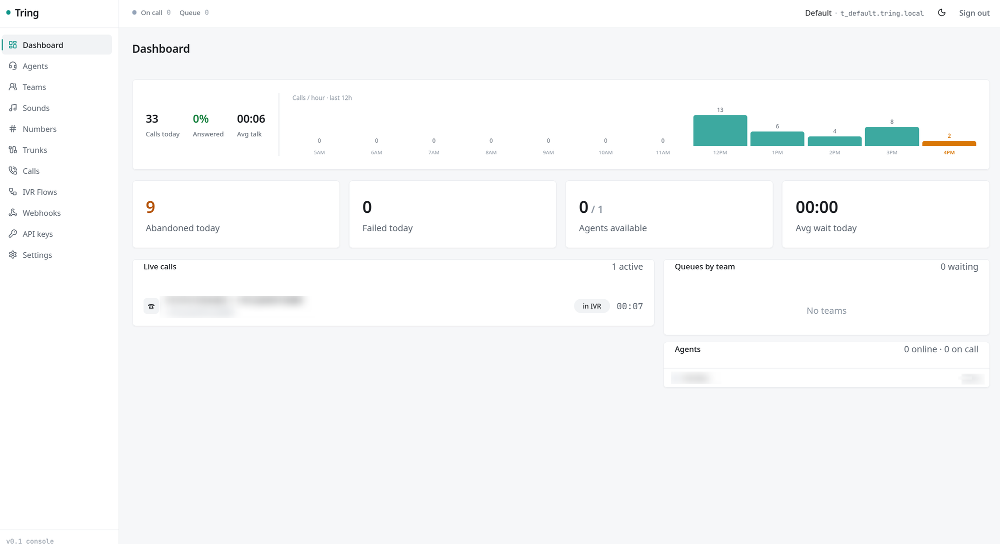

<a href="https://zerodha.tech"></a>

# Tring

Open-source, API-first voice calling for any CRM. Bring your own SIP trunk.



## Features

- **Browser calling**
  Visitors and agents call over plain WebRTC with drop-in widgets. No SIP in the browser, no plugins.

- **Visual IVR builder**
  Drag-and-drop flows with menus, input, HTTP callbacks and transfers, a live simulator, and text-to-speech prompts.

- **Agent routing**
  Teams with ring-all, round-robin, sequential and longest-wait strategies, live presence and queue depth.

- **Bring your own trunk**
  Airtel, Jio, Tata or any SIP carrier, with IP or registration auth and multi-trunk failover. Switching carriers is a config change.

- **WhatsApp calls**
  Take WhatsApp Business calls over SIP into the same flows and agents.

- **Call control**
  Hold, transfer and live supervision (monitor, whisper, barge).

- **Recording**
  Stereo call recordings (agent and customer on separate channels), stored locally or on S3.

- **Call logs & webhooks**
  One call log for every channel, a per-call timeline, and signed `call.*` webhooks.

- **Multi-tenant**
  Isolated tenants with their own API keys, admin console and trunks.

## Installation

### Docker

Pre-built images are on Docker Hub (`shridh0r/tring-api`, `tring-gateway`, `tring-freeswitch`).

```bash
# Download the installer, read it, then run it (creates ./tring)
curl -fsSLO https://raw.githubusercontent.com/shridarpatil/tring/main/install.sh
less install.sh
sh install.sh && cd tring

# Configure, then start (install.sh generated .env with random secrets)
$EDITOR .env            # network IPs, TZ
docker compose pull && docker compose up -d
```

Go to `http://localhost:8085/admin/` and log in with `TRING_ADMIN_EMAIL` / `TRING_ADMIN_PASSWORD` from `.env`.

__________________

### Build from Source

```bash
git clone https://github.com/shridarpatil/tring.git
cd tring
make .env               # copies .env.example with random secrets
docker compose up -d --build
```

See the [documentation](https://shridarpatil.github.io/tring/) for the quickstart, configuration, carrier and WhatsApp setup, the browser SDK and the full API reference. Its source is in [`docs/`](docs/).

## Developers

The backend is Go (two binaries: `cmd/api` for the REST API and console, `cmd/gateway` for the call plane) with FreeSWITCH as the carrier edge. The console is Vue 3.

```bash
docker compose up -d   # Postgres, Redis, FreeSWITCH
make api               # REST API + console on :8085
make gateway           # call plane on :8087
make help              # all targets (sdk, images, test, …)
```

Read the [architecture](https://shridarpatil.github.io/tring/architecture/overview/) and [code style](https://shridarpatil.github.io/tring/contributing/code-style/) guides before contributing.

## License

[Apache-2.0](LICENSE)
